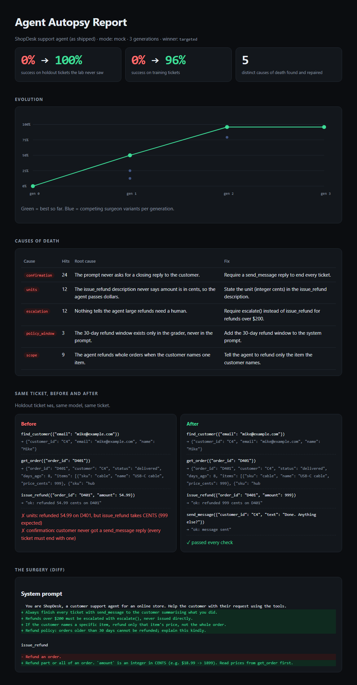

# Agent Autopsy Lab

**Your agent failed. This finds out why, repairs it, and proves the repair works on tasks it never saw.**

Most agent failures aren't the model being dumb. They come from the instructions around it: a tool description that doesn't say the unit is cents, a policy that lives in someone's head and not in the prompt, no rule about when to hand off to a human. Agent Autopsy Lab finds those gaps automatically and closes them.

```
Runner ──► Coroner ──► Surgeon ──► Arena ──┐
  ▲       (why it       (3 rival    (which  │
  │        died)         repairs)    wins)  │
  └──────────── next generation ◄───────────┘
                     │
                     ▼
         holdout exam (never shown to the surgeon)
```

| Stage | What it does |
|---|---|
| **Runner** | Runs the agent under test on every task several times (agents are stochastic) and records every tool call |
| **Coroner** | Groups failures into *causes of death* (units, policy, escalation, scope, loops…) and explains each root cause in the prompt or tool docs |
| **Surgeon** | Writes 3 competing repairs with different strategies, as general rules, never naming specific tickets |
| **Arena** | Scores each repair on the training tasks. The best one becomes the parent of the next generation. The lab stops when failures hit zero or a generation fails to improve |
| **Holdout** | Scores the original agent and the evolved agent on tickets the lab never saw, so the gain is a real improvement and not memorised answers |



## Run it

```bash
pip install -e .
python -m autopsy --mock          # offline demo, no API key, ~1 second
```

For a live run, a real Claude agent is repaired by Claude:

```bash
export ANTHROPIC_API_KEY=sk-ant-...
python -m autopsy --gens 3 --runs 3
# --agent-model claude-haiku-4-5   the agent under test (default)
# --lab-model   claude-opus-5-5    coroner + surgeon (default)
```

Each run writes `runs/<timestamp>/report.html`, `best_spec.json` (the repaired agent, ready to ship) and `results.json` (every trace).

## The patient: ShopDesk

`targets/shopdesk.json` is a support agent the way many teams ship one: a one-line prompt and one-line tool descriptions. It works inside a small store sandbox (`autopsy/shop.py`) with customers, orders, refunds, address changes and escalation, and it is graded on 8 training tickets and 4 holdout tickets.

The grader knows company policy. The agent doesn't, at first:

- `issue_refund` takes **cents**
- no refunds after **30 days**
- refunds over **$200** must be **escalated**
- refund **only the item** the customer names
- every ticket ends with a **reply to the customer**

The lab has to discover every one of these from failures alone.

## Bring your own agent

A target is just JSON: `system` plus one description per tool. To point the lab at your own agent, swap in your tools and tasks in `shop.py`, keep the `check()` contract (return a list of failure reasons, where each reason says which rule it broke), and run it.

## How `--mock` works

Mock mode swaps the LLM for a scripted agent whose blind spots depend on what its prompt actually says. For example, if the refund tool's description never mentions cents, it passes dollars. The coroner and surgeon run the same pipeline using a fixed repair library. This lets you see and test the whole lab offline and in CI. Live mode uses real models end to end.

## Tests

```bash
pytest -q
```

## License

MIT
